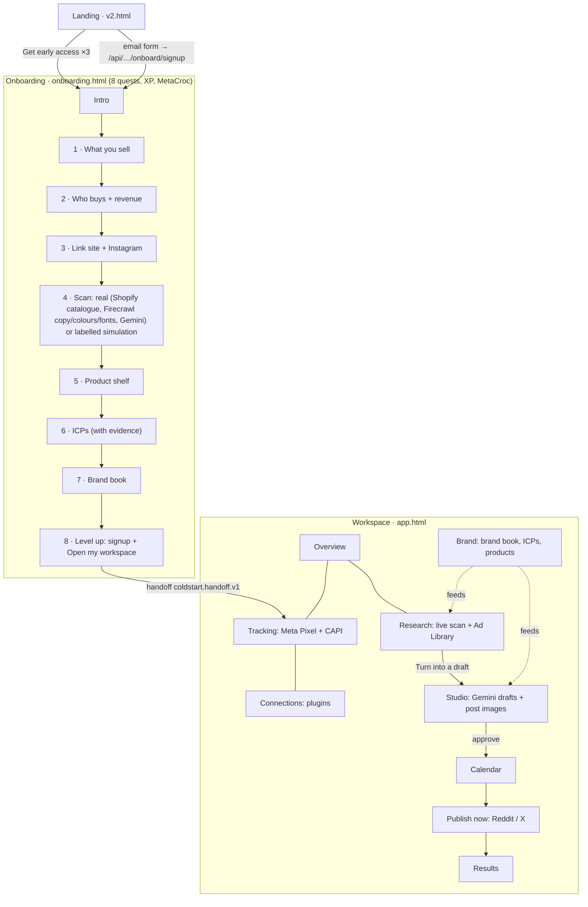

# Coldstart: user flow and gaps

Status as of 18 Nov 2026. Live URL: https://coldstart-swart-chi.vercel.app

## The flow

| # | Step | Where | What it does now | Live or sample |
|---|---|---|---|---|
| 1 | Land | `v2.html` | Story, clips, three CTAs → onboarding; email form saves to `/api/plugins/onboard/actions/signup` | Live |
| 2 | Brief | `onboarding.html` q1–q3 | Product, category, ICP or competitors, revenue, site, Instagram | Browser state |
| 3 | Scan | q4 | Shopify `products.json` + Firecrawl scrape (`branding`) + Gemini ICPs/brand book; MetaCroc while it runs (≈15–25 s) | **Live** when the API is up; labelled simulation otherwise |
| 4 | Review | q5–q7 | Real product photos/prices; ICP cards with source evidence; real colours and fonts, voice, say / don't say | Live data |
| 5 | Commit | q8 | Signup stored server-side; **Open my workspace** writes the hand-off | Live |
| 6 | Workspace import | `app.html` | Brand name, URL, line, voice, avoid list, main ICP, brand book, products, competitors (imported once) | Live data |
| 7 | Measure | Tracking | Meta connect → dataset → snippet / Shopify custom pixel → test event → stats | Sandbox until Meta keys; token path live |
| 8 | Listen | Research | Reddit / X / Instagram scan, Gemini tags; Ad Library teardowns | Live (Ad Library needs `TREG_TOKEN`) |
| 9 | Make | Studio | Gemini drafts (brand voice + main ICP), image generation | Live |
| 10 | Ship | Studio / Calendar | Approve → schedule → Publish now (Reddit, X) | Approval and calendar are browser-local; publishing is sandbox until app keys |
| 11 | Learn | Results | Sample charts | **Sample** |

## Gaps, by priority

### P0: breaks the promise for a real user
| Gap | Why it matters | Fix |
|---|---|---|
| No accounts or login | All workspace state lives in one browser (localStorage). Clearing it or switching devices loses everything; the public URL is shared by everyone. | Email magic-link auth (signup already captures email) + server-side workspace store (KV/D1) keyed by user. |
| Store is per-instance on Vercel | Signups, relay site keys, Shopify routes and budgets use `/tmp` without KV, so signups can vanish. | Accept the Upstash terms (link given earlier), then `vercel integration add upstash`. |
| Instagram isn't read in onboarding | The onboarding promises "read your Instagram". It now says it didn't read it, but there's no data behind it. | `TREG_TOKEN` → treg Instagram profile/posts tool in the onboard scan. |
| Meta live mode needs the user's Meta app | Tracking stays in sandbox for OAuth; only the token path is real. | Create the Meta app and add `META_APP_ID`/`SECRET` (docs/META-SETUP.md). App Review is needed for other brands. |
| Results page is fiction | "Learn" closes the loop and it's the least real step. | Meta Insights (ads_read) + CAPI stats + Reddit/X post metrics into Results. |

### P1: flow friction
| Gap | Fix |
|---|---|
| Onboarding → Tracking hand-off lands on Meta connect, but the Shopify store from onboarding isn't pre-filled into the Shopify connect form. | Pass `brand.url` into `S.tracking.store` when the domain is `*.myshopify.com`, or ask once. |
| Onboarding promises "a first Meta ad", but there's no Ads plugin. Ads page drafts are local. | Ads plugin: Marketing API campaign/ad set/creative in PAUSED state, built from brand book + post image. |
| Calendar has no scheduler; "scheduled" posts never fire by themselves. | Vercel Cron (or the Cloudflare worker) calling a publish job over server-side posts. |
| Instagram and Facebook Page publishing missing. | Meta plugin: `pages_manage_posts`, `instagram_content_publish` (needs the image URLs: move images from IndexedDB to R2). |
| Shopify blog publishing missing. | Shopify plugin `write_content` scope → Article API. |
| Images live only in the browser that made them. | Upload to Cloudflare R2 from the image worker and store the URL. |
| Competitor names from onboarding aren't used by Research. | Pre-fill Competitors → Ad Library search with the named rivals. |
| No re-run of the scan from the workspace. | "Rescan site" on Brand, calling the same `onboard/scan`. |

### P2: polish and trust
| Gap | Fix |
|---|---|
| Two versions of the landing page (`v2.html` live, `v2-copy.html` no-dither draft) plus `index.html` (v1). | Pick one; redirect the others. |
| Legacy simulated Tracking actions remain in workspace.js (install-dialog, scan-theme…). | Delete the dead code. |
| No privacy policy / terms / data deletion. | Required for Meta App Review and Shopify listing. |
| Onboarding XP and level are cosmetic and not carried into the app. | Show the level in the sidebar; award XP for Pixel verified, first post, etc. |
| No analytics on the funnel itself. | Log onboarding step views and completions server-side (no third-party trackers). |
| Spend caps are global, not per user. | Per-account quotas once auth exists. |
| The new brand icons (Facebook, Instagram, Reddit, WhatsApp) aren't used yet; there's no WhatsApp channel. | Use them in Connections / platform chips; decide whether WhatsApp is in scope. |
